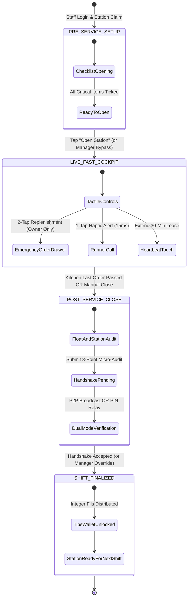
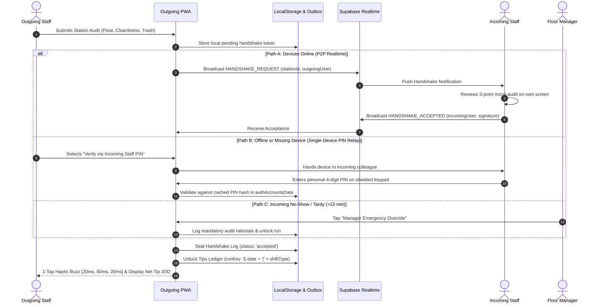

# FOH Fast-Service Cockpit & Tactile Shift Flow

* **Author:** FadiAyoub
* **Status:** Draft
* **Date:** 2026-11-08

--------------------------------------------------------------------------------

## Overview

A mobile-first, high-tempo operational cockpit for Front of House (FOH) restaurant and bar service at CEEN / Oasis. Re-architects the existing `foh-opening` PWA into a tri-phase operational engine (Pre-Service Setup, Live-Service Cockpit, Post-Service Close & Handover). Restricts live floor replenishment to designated Station Owners with keepalive leases, and enforces mutual 1-tap incoming-receiver handshakes for shift closures and tip distribution.

## The Problem

During peak restaurant and bar service (40+ active tables), waitstaff abandon opening and closing checklists. The current interface stacks checklists, scheduled chores, operations lifecycle bars, and long order catalogs into a continuous >1500px scrollable column. Carrying trays under time pressure, staff experience severe scroll fatigue and cognitive friction from multi-field forms. Consequently:
1. Staff stop using the app during live service.
2. Multiple waiters independently order duplicate supplies from the bar/store.
3. Outgoing staff unilaterally roll over incomplete chores into the next shift to unlock their exit without verifying station cleanliness or cash drawer floats.

## Goals

* **Single-Handed Cockpit (<42px Footprint):** Replace bulky headers with a unified, high-contrast operational status bar strictly $\le 42\text{px}$ high with zero scroll fatigue.
* **Tri-Phase Operational Lifecycle:** Segment the UI into three distinct state-machine phases: Pre-Service Opening, Live-Service Cockpit, and Post-Service Close.
* **Station Ownership Replenishment:** Restrict emergency station supply requests (2-tap replenishment) to a single designated Station Owner with a 30-minute keepalive lease, eliminating duplicate orders.
* **Mutual Handshake Shift Handover:** Require dual-party verification (P2P Realtime or Single-Device PIN Relay) from the incoming shift receiver before closing shifts and unlocking integer-fils tip distribution.
* **Offline-First PWA Parity:** Guarantee 100% functionality without internet across all Android and iOS devices, with optimistic local updates and an idempotent outbox replay queue.

## Non-Goals

* Kitchen (BOH) prep lists, production line recipe yields, and ingredient scaling.
* Guest-facing table POS payment terminal processing and external credit card gateway integration.
* Central restaurant ERP general ledger accounting outside of shift cash float and tip pool apportionment.

## Open Questions

* **Question 1**: Should the 30-minute station lease automatically renew on any screen touch within the station cockpit, or only upon explicit completion of a task/order? (Resolution: Renew on any user interaction within the cockpit to avoid accidental expiry during continuous table service).
* **Question 2**: For Single-Device PIN Relay, where should employee 4-digit PIN hashes be cached to enable offline verification when the incoming staff device is unavailable? (Resolution: In `foh-opening.erpSession.v1` / `foh-opening.authAccountsData` within client encrypted local storage).

## Critical User Journeys (CUJs)

### CUJ 1: Pre-Service Station Opening & Handover to Live Cockpit
* **Given**: A Super Waiter logs into `foh-opening` on a mobile device and claims ownership of the "Floor & Dining Tables" station.
* **When**: The waiter completes all mandatory checklist items marked `isCritical: true` (table alignment, cutlery rollups, table lamps) and taps "Open Station for Service".
* **Then**: The interface transitions state from `PRE_SERVICE` to `LIVE_COCKPIT`. All opening task cards collapse, the top bar shrinks to 42px, and the 2-tap Emergency Replenishment drawer and Runner Call button become active.

### CUJ 2: Live Peak Service Emergency Replenishment
* **Given**: The station is in `LIVE_COCKPIT` mode under heavy table turnover, and napkins and water glasses run low.
* **When**: The designated Station Owner taps the bottom tactile drawer, selects "Napkins", and taps "+2 Packs" (2 taps total).
* **Then**: An order payload is stamped automatically with station ID, owner username, and timestamp, haptic pulse (`15ms`) fires, and the request dispatches to the central store outbox queue. If a non-owner attempts the request, the UI routes it to the Station Owner for 1-tap proxy confirmation.

### CUJ 3: Shift Handover & Mutual Tip Unlocking
* **Given**: The dinner shift ends, kitchen Last Order has passed, and the outgoing waiter initiates shift handover.
* **When**: The outgoing waiter verifies station cleanliness, enters the closing cash drawer float, and presents the handshake request to the incoming night-shift waiter.
* **Then**: The incoming waiter inspects the 3-point micro-audit checklist (Float Verified, Surfaces Sanitized, Trash Emptied) and taps "Accept Handover" (or enters 4-digit PIN on the outgoing phone). The system seals the shift run, writes the cryptographic receipt, and immediately unlocks the outgoing waiter's exact integer-fils tip wallet.

## Technical Plan (Architecture)

### 1. Component Architecture & Domain Decomposition

To comply with the clean-code function limit (<80 lines per sub-renderer) and maintain strict domain boundaries, three dedicated modules are introduced under `foh-opening/js/domains/shifts/`:

```
foh-opening/js/
├── domains/
│   ├── shifts/
│   │   ├── cockpit-state.js       <-- NEW: FSM lifecycle & compact <42px header coordinator
│   │   ├── station-ownership.js   <-- NEW: 30-min keepalive leases & proxy authorization
│   │   ├── mutual-handshake.js    <-- NEW: Dual-mode verification (P2P + PIN Relay) & receipt
│   │   ├── role-identity.js       <-- MODIFIED: Incorporate Station Owner & Handover perms
│   │   └── shift-handover.js      <-- MODIFIED: Delegate closure gate to mutual-handshake.js
│   ├── orders/
│   │   ├── orders-store.js        <-- MODIFIED: Add Station Owner authorization guard
│   │   └── orders-view.js         <-- MODIFIED: Render 2-tap Emergency Replenishment drawer
│   └── tips/
│       └── tips-store.js          <-- MODIFIED: Gate tip status on handshake verification
└── sw.js                          <-- MODIFIED: Cache bump to v54 and precache new modules
```

### 2. Operational Lifecycle Finite State Machine (FSM)

The application moves between three mutually exclusive states governed by `cockpit-state.js`:



### 3. Dual-Mode Handshake Verification Protocol

Shift closure and tip unlocking use a resilient dual-path verification engine:



### 4. Storage Schemas & Invariant Contracts

1. **`foh-opening.cockpitPhase.v1`**:
   ```typescript
   interface CockpitPhaseState {
     phase: 'PRE_SERVICE' | 'LIVE_COCKPIT' | 'POST_SERVICE';
     stationId: string;
     claimedBy: string;
     startedAt: string;
     updatedAt: string;
   }
   ```
2. **`foh-opening.stationLeases.v1`**:
   ```typescript
   interface StationLeaseRegistry {
     [stationId: string]: {
       ownerUsername: string;
       claimedAt: string;
       expiresAt: string; // 30-min rolling lease
       lastInteractionAt: string;
       proxyDelegatedTo?: string; // Captain proxy username if active
     };
   }
   ```
3. **`foh-opening.handshakeLog.v1`**:
   ```typescript
   interface HandshakeRecord {
     runKey: string; // e.g. "2026-11-08|opening"
     stationId: string;
     outgoingUser: string;
     incomingUser: string;
     status: 'pending' | 'accepted' | 'disputed' | 'manager_override';
     authType: 'p2p_realtime' | 'pin_relay' | 'manager_override';
     cashFloatFils: number; // Integer fils
     microAudit: {
       floatVerified: boolean;
       surfacesSanitized: boolean;
       trashEmptied: boolean;
     };
     sealedAt: string;
     overrideReason?: string;
   }
   ```
4. **`foh-opening.outbox.v1`**:
   ```typescript
   interface OutboxAction {
     actionId: string; // UUID v4
     type: 'HANDSHAKE_COMPLETED' | 'ORDER_EMERGENCY' | 'STATION_LEASE_ACQUIRED';
     payload: Record<string, unknown>;
     createdAt: string;
     attempts: number;
   }
   ```

## Alternatives Considered

### Alternative A: Unrestricted Multi-Waiter Floor Replenishment Ordering
* **Pros**: Simple UI without station ownership checking; any waiter can fire orders immediately without finding the lead.
* **Cons**: Severe duplicate order clutter. In field testing, three floor waiters simultaneously ordered napkins and water glasses during a Friday dinner rush, overwhelming the central store runner.
* **Reason for Rejection**: Rejected by author: Creates severe order duplication in the bar and store during rush hours when multiple staff notice depleted supplies simultaneously.

### Alternative B: Unilateral Waiter Self-Signoff for Shift Handover
* **Pros**: Zero wait time at end of shift; outgoing staff can mark tasks complete and leave immediately.
* **Cons**: Incentivizes fraudulent compliance. Staff rushing to catch late-night transport mark messy tables as clean, transfer broken balances, and claim unverified tip distributions.
* **Reason for Rejection**: Rejected by author: Incentivizes rushed, unverified sign-offs to unlock tip shares before catching transport home without checking cash float or cleanliness.

### Alternative C: Continuous Single-Page Checklist Layout
* **Pros**: No mode transitions; all components rendered in one DOM container.
* **Cons**: Creates a >1500px vertical scroll container. Waiters abandon the app completely during live service because opening tasks, scheduled chores, and order catalogs push live controls off-screen.
* **Reason for Rejection**: Rejected by author: Waiters ignore phones entirely when forced to scroll through completed opening tasks to find live actions.

### Alternative D: Native Mobile Application Rewrite (React Native / Flutter / Kotlin)
* **Pros**: Direct access to OS Bluetooth, background threads, and native push tokens.
* **Cons**: High development overhead, app store review delays, and severe installation friction across personal devices of high-turnover hospitality staff.
* **Reason for Rejection**: Rejected by author: Violates the zero-install PWA constraint and introduces platform fragmentation across staff personal devices.

## Detailed Implementation Plan

The implementation proceeds across four verified milestones with zero design ambiguity left to the implementer:

### 1. File Changes Matrix & Rationales

| File Path | Action | Rationale |
| :--- | :--- | :--- |
| `foh-opening/js/domains/shifts/cockpit-state.js` | Create | Implements the FSM state machine (`PRE_SERVICE`, `LIVE_COCKPIT`, `POST_SERVICE`), manages active station phase persistence in `foh-opening.cockpitPhase.v1`, and renders the ultra-compact $\le 42\text{px}$ operational header bar. |
| `foh-opening/js/domains/shifts/station-ownership.js` | Create | Manages Station Ownership claims, 30-minute rolling keepalive leases, auto-renewal on user touch events, captain proxy delegation, and provides the `canUserOrderForStation(stationId, username)` guard. |
| `foh-opening/js/domains/shifts/mutual-handshake.js` | Create | Implements dual-mode shift handover verification (Path A: P2P Supabase Realtime broadcast; Path B: Single-Device PIN Relay), renders the 3-point micro-audit checklist (float, cleanliness, trash), and writes the cryptographic receipt. |
| `foh-opening/tests/cockpit-flow.test.mjs` | Create | Automated Node.js unit tests asserting FSM state transitions, lease expiration auto-proxy, duplicate order rejection, and handshake tip unlocking invariants. |
| `foh-opening/js/domains/orders/orders-store.js` | Modify | Injects `canUserOrderForStation()` check into `addItem()` and order line mutations to enforce single Station Owner order exclusivity. |
| `foh-opening/js/domains/orders/orders-view.js` | Modify | Embeds the 2-tap Emergency Replenishment drawer for the top 8 depletion items (Napkins, Glasses, Ice, Citrus, Straws, Cutlery, Sanitizer, Paper) with 15ms haptic confirmation. |
| `foh-opening/js/domains/shifts/shift-handover.js` | Modify | Replaces the unverified unilateral `rolloverTasksToNextShift()` with the `mutual-handshake.js` verification gate. |
| `foh-opening/js/domains/tips/tips-store.js` | Modify | Enforces that tip runs cannot transition to `distributed` unless `handshakeLog[runKey].status === 'accepted'` or an explicit manager override is present. |
| `foh-opening/js/domains/navigation/bottom-bar.js` | Modify | Injects the 1-tap "Runner Call" emergency trigger into the mobile thumb zone and ensures safe-area offset padding: `calc(var(--tab-bar-height, 68px) + env(safe-area-inset-bottom, 16px))`. |
| `foh-opening/sw.js` | Modify | Bumps service worker cache name to `super-employee-v54-fast-cockpit` and adds the 3 new shift modules to `PRECACHE`. |
| `foh-opening/index.html` | Modify | Adds script tags for `cockpit-state.js`, `station-ownership.js`, and `mutual-handshake.js` before `app.js`. |
| `foh-opening/js/domains/shifts/README.md` | Modify | Documents new module symbols, invariants, and side effects according to EGM Component Package standards. |
| `foh-opening/README.md` | Modify | Updates the system blueprint overview and global invariant list with tri-phase cockpit and lease rules. |

### 2. Milestone Execution Sequence

1. **Milestone 1: Core State Machine & Station Ownership Modules**
   - Implement `cockpit-state.js` (<80 lines per sub-renderer) implementing state persistence and header renderer.
   - Implement `station-ownership.js` with 30-min heartbeat timer and `canUserOrderForStation()` API.
   - Wire tests in `tests/cockpit-flow.test.mjs` verifying FSM states and lease renewals.
2. **Milestone 2: Tactile 2-Tap Replenishment & Order Exclusivity**
   - Update `orders-store.js` to reject non-owner order mutations.
   - Update `orders-view.js` to render the bottom drawer containing the 8 pre-seeded quick depletion tiles.
   - Wire tactile feedback (`navigator.vibrate(15)`).
3. **Milestone 3: Mutual Handshake & Tip Wallet Gate**
   - Implement `mutual-handshake.js` supporting both Supabase Realtime broadcast and single-device 4-digit PIN keypad entry.
   - Update `shift-handover.js` and `tips-store.js` to lock tip status until handshake receipt is verified.
   - Test offline PIN relay fallback in `tests/cockpit-flow.test.mjs`.
4. **Milestone 4: Shell Integration, Service Worker & Documentation**
   - Update `index.html` script loading tags.
   - Bump cache in `sw.js` to `super-employee-v54-fast-cockpit`.
   - Update `js/domains/shifts/README.md` and root `foh-opening/README.md`.
   - Run complete test suite: `node --test foh-opening/tests/*.test.mjs`.
