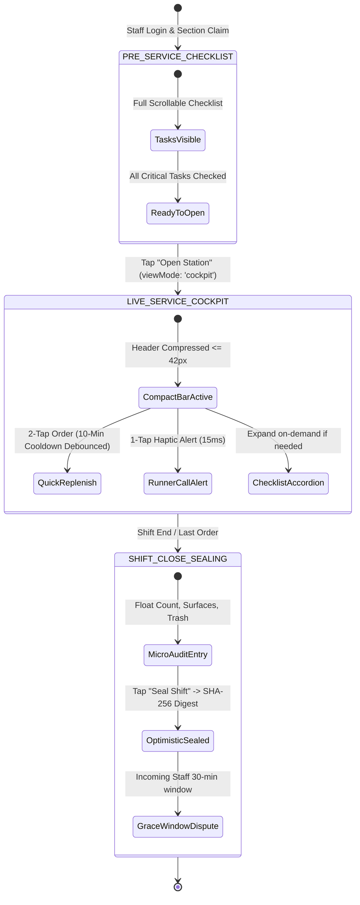
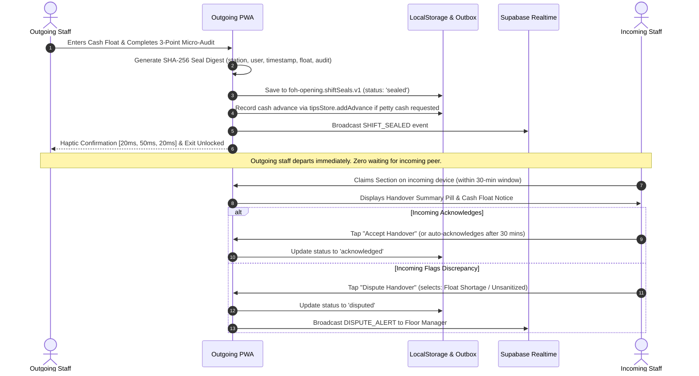

# FOH Fast-Service Cockpit & Tactile Shift Flow

* **Author:** FadiAyoub
* **Status:** Approved
* **Date:** 2026-11-08

--------------------------------------------------------------------------------

## Overview

A mobile-first, high-tempo operational cockpit for Front of House (FOH) restaurant and bar service at CEEN / Oasis. Re-architects the existing `foh-opening` PWA to eliminate the >1500px vertical scroll container during live service by introducing a compact ($\le 42\text{px}$) operational header bar, an active cockpit presentation mode toggle, 2-tap department-scoped emergency replenishment with 10-minute cooldown debouncing, and an Asynchronous Optimistic Shift Sealing protocol with tamper-evident SHA-256 audit digests and cash float reconciliation.

## The Problem

During peak restaurant and bar service (40+ active tables), waitstaff abandon opening and closing checklists. The current interface stacks checklists, scheduled chores, operations lifecycle bars, and long order catalogs into a continuous >1500px scrollable column. Carrying trays under time pressure, staff experience severe scroll fatigue and cognitive friction from multi-field forms. Consequently:
1. Staff stop using the app during live service.
2. Multiple waiters independently order duplicate supplies from the bar/store without coordination.
3. Outgoing staff unilaterally roll over incomplete chores into the next shift to unlock their exit without verifying station cleanliness or cash drawer floats.

## Goals

* **Single-Handed Cockpit (<42px Footprint):** Replace bulky headers with a unified, high-contrast operational status bar strictly $\le 42\text{px}$ high with zero vertical scroll fatigue.
* **Streamlined Presentation Mode Toggle:** Integrate a lightweight `viewMode: 'checklist' | 'cockpit'` toggle directly into `ops-lifecycle.js` to collapse opening chores during live service without spawning parallel state machines.
* **Tactile 2-Tap Replenishment with Cooldown Debouncing:** Deliver a 2-tap bottom drawer for high-velocity supplies (department-scoped to floor vs. bar) with 10-minute cooldown debouncing per item, eliminating duplicate orders without blocking staff.
* **Asynchronous Optimistic Shift Sealing:** Outgoing staff seal shifts optimistically with a tamper-evident SHA-256 digest, recording cash float reconciliation and optional petty cash advances (`tipsStore.addAdvance`), granting incoming staff a 30-minute grace window to acknowledge or dispute.
* **Weekly Tip Pool Domain Integrity:** Maintain the strict weekly tip pool invariant (`super-employee.tips.v1`) using Hamilton's largest-remainder apportionment calculated at week close, avoiding fictitious daily shift tip distribution locks.
* **Offline-First PWA Parity:** Guarantee 100% functionality without internet across all Android and iOS devices, with optimistic local updates and an idempotent outbox replay queue.

## Non-Goals

* Kitchen (BOH) prep lists, production line recipe yields, and ingredient scaling.
* Guest-facing table POS payment terminal processing and external credit card gateway integration.
* Central restaurant ERP general ledger accounting outside of shift cash float variance and petty cash advances.
* Multi-device synchronous P2P WebRTC/WebSocket handshake negotiation that causes staff exit gridlock.

## Open Questions & Resolutions

* **Question 1**: How to prevent duplicate emergency replenishment orders during rush hours without introducing frustrating user locks?
  - *Resolution*: Implement a 10-minute "En Route" cooldown debouncing per item in `orders-store.js`. During the cooldown, an item tile displays an active delivery badge with a "+1 More" modifier that increments line quantity instead of firing duplicate orders.
* **Question 2**: How to verify station handovers reliably without staff sharing PINs or blocking outgoing staff waiting for tardy incoming colleagues?
  - *Resolution*: Asynchronous Optimistic Sealing. The outgoing staff verifies cash drawer float, completes a 3-point micro-audit, and signs the shift seal. The system computes a local SHA-256 audit digest. The incoming receiver has a 30-minute non-blocking grace window to acknowledge or dispute upon claiming the station.
* **Question 3**: How does shift handover interact with employee tip distribution?
  - *Resolution*: Tips are strictly an immutable weekly pool apportioned at week close via `tips-store.js`. Shift handover tracks cash drawer float and issues optional mid-shift petty cash advances via `FOH.tipsStore.addAdvance(employeeId, amountJOD, note, managerName)` deducted from the employee's weekly allocation.

## Critical User Journeys (CUJs)

### CUJ 1: Pre-Service Station Opening & Cockpit Mode Activation
* **Given**: A Super Waiter logs into `foh-opening` on a mobile device and claims ownership of the "Floor & Dining Tables" section via `section-claims.js`.
* **When**: The waiter completes mandatory checklist items marked `isCritical: true` and taps "Open Station for Service".
* **Then**: `ops-lifecycle.js` toggles `viewMode` to `'cockpit'`. Opening checklist cards collapse into a compact summary indicator, the top bar compresses to $\le 42\text{px}$, and the 2-tap Quick Replenishment drawer and Runner Call alert button become primary active touch targets.

### CUJ 2: Live Peak Service Emergency Replenishment
* **Given**: The station is in `'cockpit'` mode during heavy table turnover, and napkins and water glasses run low.
* **When**: The waiter taps the bottom replenishment drawer, taps "Napkins", and taps "+2 Packs" (2 taps total).
* **Then**: An order payload is dispatched automatically with station ID, user identity, and timestamp, haptic pulse (`15ms`) fires, and the request enters the outbox. For the next 10 minutes, the Napkins tile displays "En Route (10m) - Tap to Add +1", preventing duplicate runner dispatches.

### CUJ 3: Shift Handover & Optimistic Shift Sealing
* **Given**: The dinner shift ends, Last Order has passed, and the outgoing waiter initiates shift closing.
* **When**: The outgoing waiter counts the cash drawer float, completes the 3-point micro-audit checklist (Float Verified, Surfaces Sanitized, Trash Emptied), and taps "Seal Shift Handover".
* **Then**: The system generates a tamper-evident SHA-256 seal digest in `foh-opening.shiftSeals.v1`, logs any cash float variance, records petty cash advances if requested, triggers a distinct haptic pulse (`[20ms, 50ms, 20ms]`), and allows the outgoing staff to depart immediately. The incoming staff receives a 30-minute review window upon station claim to accept or file an audit dispute.

## Technical Plan (Architecture)

### 1. Component Architecture & Domain Decomposition

To comply with the clean-code function limit (<80 lines per sub-renderer) and maintain strict domain boundaries, new modules and modifications are distributed across existing domains:

```
foh-opening/js/
├── core/
│   └── i18n.js                       <-- MODIFIED: Arabic/English cockpit translation pairs
├── domains/
│   ├── operations/
│   │   └── ops-lifecycle.js          <-- MODIFIED: Incorporate viewMode ('checklist' | 'cockpit')
│   ├── navigation/
│   │   └── landing-hero.js           <-- MODIFIED: Render <=42px compact bar & Runner Call button
│   ├── orders/
│   │   ├── orders-catalog-data.js    <-- MODIFIED: Tag top 8 emergency items with isQuickReplenish & dept
│   │   ├── orders-store.js           <-- MODIFIED: Add canQuickReplenish() 10-min cooldown debouncing
│   │   └── orders-view.js            <-- MODIFIED: Embed 2-tap tactile replenishment drawer (<80 lines)
│   └── shifts/
│       ├── shift-sealing.js          <-- NEW: Asynchronous Optimistic Sealing & 30-min dispute manager
│       └── shift-handover.js         <-- MODIFIED: Delegate shift sealing to shift-sealing.js
├── tests/
│   └── cockpit-flow.test.mjs         <-- NEW: Unit tests for cooldowns, sealing hash, and viewMode
├── index.html                        <-- MODIFIED: Load shift-sealing.js at line 533 (after shift-handover.js)
└── sw.js                             <-- MODIFIED: Bump CACHE to super-employee-v54-fast-cockpit
```

### 2. Operational Lifecycle Flow

The presentation state is governed by `ops-lifecycle.js` without requiring an isolated parallel FSM:



### 3. Asynchronous Optimistic Sealing Protocol

Shift handover uses asynchronous optimistic sealing to eliminate staff exit bottlenecks:



### 4. Storage Schemas & Invariant Contracts

1. **`foh-opening.shiftSeals.v1`**:
   ```typescript
   interface ShiftSealRecord {
     sealId: string; // SHA-256 digest substring / UUID
     runKey: string; // e.g. "2026-11-08|dinner"
     stationId: string;
     outgoingUser: string;
     incomingUser?: string;
     status: 'sealed' | 'acknowledged' | 'disputed';
     cashFloatFils: number; // Integer fils
     cashVarianceFils: number;
     pettyCashAdvanceFils?: number;
     microAudit: {
       floatVerified: boolean;
       surfacesSanitized: boolean;
       trashEmptied: boolean;
     };
     disputeReason?: string;
     disputedAt?: string;
     sealedAt: string;
     auditDigest: string; // SHA-256 hash string
   }
   ```

2. **`foh-opening.quickReplenishCooldowns.v1`**:
   ```typescript
   interface QuickReplenishCooldowns {
     [itemKey: string]: {
       stationId: string;
       orderedBy: string;
       orderedAt: number; // Date.now() timestamp
       lineQty: number;
     };
   }
   ```

3. **Presentation Mode Contract in `foh-opening.sheetState.v1`**:
   ```typescript
   // Extended field in sheet state
   interface SheetStateExtension {
     viewMode: 'checklist' | 'cockpit'; // Default 'checklist' during setup, 'cockpit' during live service
   }
   ```

4. **`foh-opening.outbox.v1`**:
   ```typescript
   interface OutboxAction {
     actionId: string;
     type: 'SHIFT_SEALED' | 'QUICK_REPLENISH' | 'RUNNER_CALL' | 'HANDOVER_DISPUTED';
     payload: Record<string, unknown>;
     createdAt: string;
     attempts: number;
   }
   ```

## Alternatives Considered

### Alternative A: Hard Exclusive Station Ownership Leases
* **Description**: Restrict floor replenishment orders strictly to a single authenticated Station Owner with 30-minute keepalive leases (`station-ownership.js`).
* **Pros**: Completely prevents duplicate orders by unauthorized staff.
* **Cons**: Introduces high friction when assigned waiter is on break or handling a guest complaint. Other waitstaff cannot order needed napkins or straws without finding the lead or breaking the lease.
* **Reason for Rejection**: Pruned in Stage 8/9 review in favor of 10-minute cooldown debouncing per item with "+1 More" modifier.

### Alternative B: Synchronous P2P / Single-Device PIN Handshakes
* **Description**: Block shift closure until the incoming waiter connects via Supabase Realtime or enters their 4-digit PIN on the outgoing waiter's screen.
* **Pros**: Guarantees physical co-presence at handover moment.
* **Cons**: Causes severe staff exit bottlenecks when incoming staff are tardy or in transit. Leads to staff sharing PINs to bypass the gate, destroying security.
* **Reason for Rejection**: Pruned in Stage 8/9 review in favor of Asynchronous Optimistic Sealing with a 30-minute dispute window.

### Alternative C: Shift-Gated Daily Tip Distribution
* **Description**: Block tip payouts until each shift handover is accepted.
* **Pros**: Financial incentive for completing shift handover cleanly.
* **Cons**: Fictitious domain model: Tips in `foh-opening` are strictly a weekly pool (`super-employee.tips.v1`) evaluated at week close via Hamilton's largest-remainder apportionment. Daily payouts break the integer-fils weekly math.
* **Reason for Rejection**: Corrected in Stage 8/9 review: Shift handover reconciles cash float and records petty cash advances (`tipsStore.addAdvance`); weekly tip pool remains immutable.

### Alternative D: Unrestricted Multi-Waiter Floor Replenishment Ordering
* **Description**: Allow any staff to fire orders anytime without debouncing.
* **Pros**: Simplest code.
* **Cons**: In rush hours, multiple waiters notice depleted napkins simultaneously and spam the store.
* **Reason for Rejection**: Creates duplicate runner trips and bar order chaos.

## Detailed Implementation Plan

The implementation proceeds across four verified milestones with zero design ambiguity left to the implementer:

### 1. Reconciled File Changes Matrix

| File Path | Action | Exact Actionable Instructions |
| :--- | :--- | :--- |
| `foh-opening/js/domains/shifts/shift-sealing.js` | Create | Implements Asynchronous Optimistic Sealing with SHA-256 tamper-evident digest, renders the 3-point micro-audit drawer (<80 lines per sub-renderer), and manages the 30-min incoming dispute window in `foh-opening.shiftSeals.v1`. |
| `foh-opening/tests/cockpit-flow.test.mjs` | Create | Node.js unit tests with in-memory storage/sandbox asserting optimistic sealing hash generation, dispute flagging, and order cooldown debouncing. |
| `foh-opening/js/domains/orders/orders-catalog-data.js` | Modify | Adds `isQuickReplenish: true` and `dept: 'floor' | 'bar' | 'both'` to top 8 emergency items (Napkins, Glasses, Ice, Citrus, Straws, Cutlery, Sanitizer, Paper). |
| `foh-opening/js/domains/orders/orders-store.js` | Modify | Implements `canQuickReplenish(itemKey, stationId)` with 10-minute cooldown tracking and auto-increment quantity modifier. |
| `foh-opening/js/domains/orders/orders-view.js` | Modify | Embeds the 2-tap tactile replenishment drawer (<80 lines) populated dynamically from `isQuickReplenish` items matching the station department. |
| `foh-opening/js/domains/operations/ops-lifecycle.js` | Modify | Adds `viewMode: 'checklist' | 'cockpit'` toggle state to eliminate scroll fatigue without creating a parallel FSM. |
| `foh-opening/js/domains/navigation/landing-hero.js` | Modify | Renders ultra-compact $\le 42\text{px}$ operational header bar with $\ge 48\text{px}$ touch bleed hit-box and 1-tap Runner Call alert button. |
| `foh-opening/js/core/i18n.js` | Modify | Adds Arabic and English translations for cockpit toggle, quick replenishment items, runner call, and micro-audit checklist. |
| `foh-opening/index.html` | Modify | Appends `<script src="js/domains/shifts/shift-sealing.js?v=v54"></script>` at line 533 (after `shift-handover.js` and before `super-employee-init.js`). |
| `foh-opening/sw.js` | Modify | Bumps `CACHE` to `'super-employee-v54-fast-cockpit'` and adds `shift-sealing.js` to `PRECACHE`. |
| `foh-opening/js/domains/shifts/README.md` | Modify | Documents `shift-sealing.js` exports, invariants, and side effects. |
| `foh-opening/README.md` | Modify | Updates the system blueprint overview with fast cockpit ergonomics. |

### 2. Milestone Execution Sequence

1. **Milestone 1: Cockpit View Toggle, Compact Header & Runner Call**
   - In `foh-opening/js/domains/operations/ops-lifecycle.js`, add `viewMode: 'checklist' | 'cockpit'` property and toggle handler (`FOH.opsLifecycle.toggleViewMode()`).
   - In `foh-opening/js/domains/navigation/landing-hero.js`, render the ultra-compact $\le 42\text{px}$ header bar displaying active section, elapsed time, view toggle button, and the 1-tap "Runner Call" emergency alert (`navigator.vibrate(15)`).
   - In `foh-opening/js/core/i18n.js`, add bilingual translations:
     - `cockpit_open_station`: En: "Open Station for Service" / Ar: "فتح المحطة للخدمة"
     - `runner_call`: En: "Call Runner" / Ar: "نداء مساعد الخدمة"
     - `view_mode_cockpit`: En: "Cockpit" / Ar: "الوضع السريع"
     - `view_mode_checklist`: En: "Checklist" / Ar: "القائمة الكاملة"

2. **Milestone 2: Tactile 2-Tap Replenishment with Cooldown Debouncing**
   - In `foh-opening/js/domains/orders/orders-catalog-data.js`, flag the top 8 emergency items with `isQuickReplenish: true` and `dept: 'floor' | 'bar' | 'both'`.
   - In `foh-opening/js/domains/orders/orders-store.js`, implement `canQuickReplenish(itemKey, stationId)` returning `{ allowed: boolean, cooldownRemainingSec: number, lastOrderedBy: string }`. If within 10-minute cooldown, increment existing quantity rather than duplicating lines.
   - In `foh-opening/js/domains/orders/orders-view.js`, render the 2-tap replenishment drawer (<80 lines per sub-renderer) filtering items by active station department.
   - In `foh-opening/js/core/i18n.js`, add translation pairs for emergency items and replenishment badges (`quick_replenish`, `en_route_cooldown`).

3. **Milestone 3: Asynchronous Optimistic Shift Sealing & Cash Float Reconciliation**
   - Create `foh-opening/js/domains/shifts/shift-sealing.js` implementing:
     - `sealShift({ stationId, cashFloatFils, microAudit, advanceFils, advanceNote })`: computes SHA-256 audit digest, records petty cash advance via `FOH.tipsStore.addAdvance()` if requested, and stores seal in `foh-opening.shiftSeals.v1`.
     - `getPendingDisputes(stationId)`: checks if the previous shift was sealed within the last 30 minutes.
     - `acknowledgeSeal(sealId)` and `disputeSeal(sealId, reason)`: manages incoming receiver review.
     - Sub-renderers (<80 lines each) for the 3-point micro-audit drawer and dispute pill.
   - Update `foh-opening/js/domains/shifts/shift-handover.js` to trigger `shift-sealing.js` upon shift completion.
   - In `foh-opening/js/core/i18n.js`, add translation keys:
     - `micro_audit_float`: En: "Cash Float Verified" / Ar: "مطابقة رصيد الصندوق"
     - `micro_audit_surfaces`: En: "Surfaces Sanitized" / Ar: "تعقيم وتجهيز الطاولات"
     - `micro_audit_trash`: En: "Trash Emptied" / Ar: "تفريغ سلات المهملات"
     - `seal_shift_btn`: En: "Seal Shift Handover" / Ar: "ختم وتسليم الشفت"
     - `handover_dispute`: En: "Dispute Handover" / Ar: "اعتراض على التسليم"

4. **Milestone 4: Shell Integration, Service Worker, Localization & Test Suite Execution**
   - In `foh-opening/index.html`, append `<script src="js/domains/shifts/shift-sealing.js?v=v54"></script>` at line 533 (after `shift-handover.js`).
   - In `foh-opening/sw.js`, bump `CACHE` to `'super-employee-v54-fast-cockpit'` and add `js/domains/shifts/shift-sealing.js` to `PRECACHE`. Document rollback cache `'super-employee-v53-orders-rbac'`.
   - Create `foh-opening/tests/cockpit-flow.test.mjs` with browser API mocks (mocking `crypto.subtle`, `localStorage`, `navigator.vibrate`) verifying:
     - SHA-256 seal digest generation and verification.
     - 10-minute cooldown tracking and auto-increment behavior.
     - 30-minute dispute window expiration logic.
   - Update `foh-opening/js/domains/shifts/README.md` and `foh-opening/README.md`.
   - Run tests: `node --test foh-opening/tests/tips-calc.test.mjs foh-opening/tests/cockpit-flow.test.mjs` and verify zero regressions.
