# getDB()

> God node · 20 connections · [C:\Users\fadia\Downloads\erp-platform\foh-opening\js\domains\orders\orders-store.js](file:///C:/Users/fadia/Downloads/erp-platform/foh-opening/js/domains/orders/orders-store.js#L165)

## Call Trace Diagram

```mermaid
sequenceDiagram
    participant P0 as getDB()
    participant P1 as renderItemStepperCard()
    participant P2 as ordCatItems()
    participant P3 as renderCategoryComplete()
    participant P4 as renderCategoryStepList()
    participant P5 as renderQuickListMode()
    participant P6 as createProductPickRow()
    participant P7 as ordCatDone()
    participant P8 as ordCatSkipped()
    participant P9 as createCategoryCard()
    participant P10 as ordPendingItem()
    participant P11 as ordSkipRemaining()
    participant P12 as buildOrdBreadcrumbs()
    participant P13 as renderCategoryProducts()
    participant P14 as renderCategoryTypes()
    participant P15 as renderOrderReview()
    participant P16 as ordCat()
    participant P17 as store()
    participant P18 as isAr()
    participant P19 as ordUnitText()
    participant P20 as renderOrdersView()
    participant P21 as store()
    participant P22 as ordLine()
    participant P23 as saveOrdersDB()
    participant P24 as buildItemProductPanel()
    participant P25 as ordStockLabel()
    participant P26 as appendBottomBar()
    participant P27 as buildItemStepperControls()
    participant P28 as ordById()
    participant P29 as buildOrdViewSwitch()
    participant P30 as appendItemBottomNav()
    participant P31 as getGroupIconSvg()
    participant P32 as isAr()
    participant P33 as ordGo()
    participant P34 as buildItemProgressRail()
    participant P35 as renderHomeGroups()
    participant P36 as getOrdDB()
    participant P37 as updateQuickItemQty()
    participant P38 as getOrdDB()
    participant P39 as renderGroupConfigBody()
    participant P40 as openAddCategoryModal()
    participant P41 as buildOrdWhatsAppText()
    participant P42 as openOrdersSettingsModal()
    participant P43 as renderReviewSidebar()
    participant P44 as commitItemQty()
    participant P45 as buildAddCategoryForm()
    participant P46 as renderReviewLines()
    participant P47 as renderGroupSwitcher()
    P0->>+ P1: calls
    P1-->>- P0: return
    P1->>+ P0: calls
    P0-->>- P1: return
    P1->>+ P2: calls
    P2-->>- P1: return
    P2->>+ P1: calls
    P1-->>- P2: return
    P2->>+ P3: calls
    P3-->>- P2: return
    P2->>+ P4: calls
    P4-->>- P2: return
    P2->>+ P5: calls
    P5-->>- P2: return
    P2->>+ P6: calls
    P6-->>- P2: return
    P2->>+ P7: calls
    P7-->>- P2: return
    P2->>+ P8: calls
    P8-->>- P2: return
    P2->>+ P9: calls
    P9-->>- P2: return
    P2->>+ P10: calls
    P10-->>- P2: return
    P2->>+ P11: calls
    P11-->>- P2: return
    P1->>+ P12: calls
    P12-->>- P1: return
    P12->>+ P1: calls
    P1-->>- P12: return
    P12->>+ P0: calls
    P0-->>- P12: return
    P12->>+ P3: calls
    P3-->>- P12: return
    P12->>+ P13: calls
    P13-->>- P12: return
    P12->>+ P14: calls
    P14-->>- P12: return
    P12->>+ P15: calls
    P15-->>- P12: return
    P12->>+ P16: calls
    P16-->>- P12: return
    P12->>+ P17: calls
    P17-->>- P12: return
    P12->>+ P18: calls
    P18-->>- P12: return
    P1->>+ P19: calls
    P19-->>- P1: return
    P1->>+ P20: calls
    P20-->>- P1: return
    P1->>+ P21: calls
    P21-->>- P1: return
    P1->>+ P16: calls
    P16-->>- P1: return
    P1->>+ P22: calls
    P22-->>- P1: return
    P1->>+ P23: calls
    P23-->>- P1: return
    P1->>+ P24: calls
    P24-->>- P1: return
    P1->>+ P25: calls
    P25-->>- P1: return
    P1->>+ P26: calls
    P26-->>- P1: return
    P1->>+ P27: calls
    P27-->>- P1: return
    P1->>+ P28: calls
    P28-->>- P1: return
    P1->>+ P29: calls
    P29-->>- P1: return
    P1->>+ P30: calls
    P30-->>- P1: return
    P1->>+ P31: calls
    P31-->>- P1: return
    P1->>+ P32: calls
    P32-->>- P1: return
    P1->>+ P33: calls
    P33-->>- P1: return
    P1->>+ P34: calls
    P34-->>- P1: return
    P0->>+ P35: calls
    P35-->>- P0: return
    P0->>+ P13: calls
    P13-->>- P0: return
    P0->>+ P36: calls
    P36-->>- P0: return
    P0->>+ P14: calls
    P14-->>- P0: return
    P0->>+ P12: calls
    P12-->>- P0: return
    P0->>+ P4: calls
    P4-->>- P0: return
    P0->>+ P37: calls
    P37-->>- P0: return
    P0->>+ P5: calls
    P5-->>- P0: return
    P0->>+ P38: calls
    P38-->>- P0: return
    P0->>+ P39: calls
    P39-->>- P0: return
    P0->>+ P40: calls
    P40-->>- P0: return
    P0->>+ P41: calls
    P41-->>- P0: return
    P0->>+ P42: calls
    P42-->>- P0: return
    P0->>+ P43: calls
    P43-->>- P0: return
    P0->>+ P44: calls
    P44-->>- P0: return
    P0->>+ P45: calls
    P45-->>- P0: return
    P0->>+ P46: calls
    P46-->>- P0: return
    P0->>+ P47: calls
    P47-->>- P0: return
```

## Connections by Relation

### calls
- [[renderItemStepperCard()]] `INFERRED`
- [[renderHomeGroups()]] `INFERRED`
- [[renderCategoryProducts()]] `INFERRED`
- [[getOrdDB()]] `INFERRED`
- [[renderCategoryTypes()]] `INFERRED`
- [[buildOrdBreadcrumbs()]] `INFERRED`
- [[renderCategoryStepList()]] `INFERRED`
- [[updateQuickItemQty()]] `INFERRED`
- [[renderQuickListMode()]] `INFERRED`
- [[getOrdDB()]] `INFERRED`
- [[renderGroupConfigBody()]] `INFERRED`
- [[openAddCategoryModal()]] `INFERRED`
- [[buildOrdWhatsAppText()]] `INFERRED`
- [[openOrdersSettingsModal()]] `INFERRED`
- [[renderReviewSidebar()]] `INFERRED`
- [[commitItemQty()]] `INFERRED`
- [[buildAddCategoryForm()]] `INFERRED`
- [[renderReviewLines()]] `INFERRED`
- [[renderGroupSwitcher()]] `INFERRED`

### contains
- [[orders-store.js]] `EXTRACTED`

---

*Part of the graphify knowledge wiki. See [[index]] to navigate.*