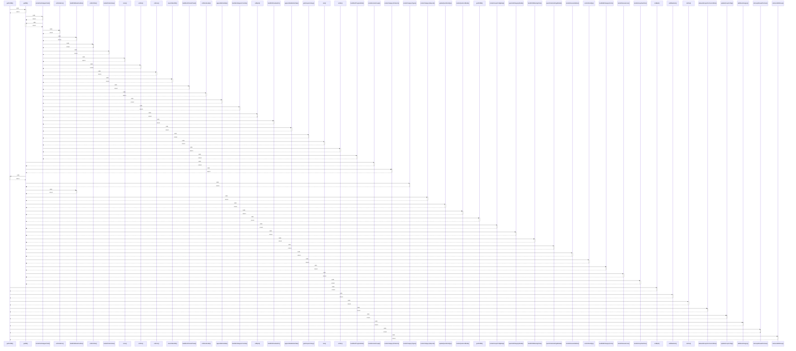

# getOrdDB()

> God node · 10 connections · [C:\Users\fadia\Downloads\erp-platform\foh-opening\js\domains\orders\orders-catalog-mutations.js](file:///C:/Users/fadia/Downloads/erp-platform/foh-opening/js/domains/orders/orders-catalog-mutations.js#L4)

## Call Trace Diagram

## Connections by Relation

### calls
- [[getDB()]] `INFERRED`
- [[ordById()]] `EXTRACTED`
- [[addNewItem()]] `EXTRACTED`
- [[ordCat()]] `EXTRACTED`
- [[allowedGroupsForCurrentRole()]] `EXTRACTED`
- [[updateGroupConfig()]] `EXTRACTED`
- [[addNewCategory()]] `EXTRACTED`
- [[isGroupAllowedForUser()]] `EXTRACTED`
- [[canUserEditGroup()]] `EXTRACTED`

### contains
- [[orders-catalog-mutations.js]] `EXTRACTED`

---

*Part of the graphify knowledge wiki. See [[index]] to navigate.*