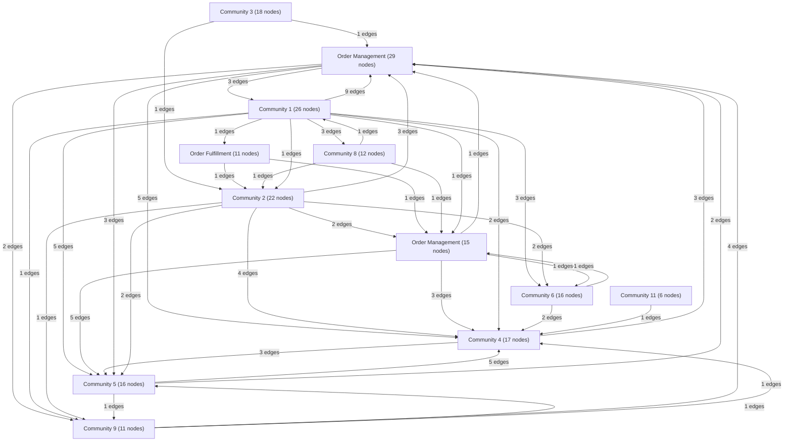

# Knowledge Graph Index

> Auto-generated by graphify. Start here — read community articles for context, then drill into god nodes for detail.

**199 nodes · 439 edges · 12 communities**

---

## System Architecture Flowchart

## Communities
(sorted by size, largest first)

- [[Order Management]] — 29 nodes
- [[Community 1]] — 26 nodes
- [[Community 2]] — 22 nodes
- [[Community 3]] — 18 nodes
- [[Community 4]] — 17 nodes
- [[Community 5]] — 16 nodes
- [[Community 6]] — 16 nodes
- [[Order Management]] — 15 nodes
- [[Community 8]] — 12 nodes
- [[Community 9]] — 11 nodes
- [[Order Fulfillment]] — 11 nodes
- [[Community 11]] — 6 nodes

## God Nodes
(most connected concepts — the load-bearing abstractions)

- [[renderItemStepperCard()]] — 21 connections
- [[getDB()]] — 20 connections
- [[renderHomeGroups()]] — 14 connections
- [[renderCategoryComplete()]] — 12 connections
- [[ordCatItems()]] — 11 connections
- [[renderCategoryProducts()]] — 11 connections
- [[getOrdDB()]] — 10 connections
- [[ordUnitText()]] — 10 connections
- [[renderCategoryTypes()]] — 10 connections
- [[buildOrdBreadcrumbs()]] — 10 connections

---

*Generated by [graphify](https://github.com/safishamsi/graphify)*