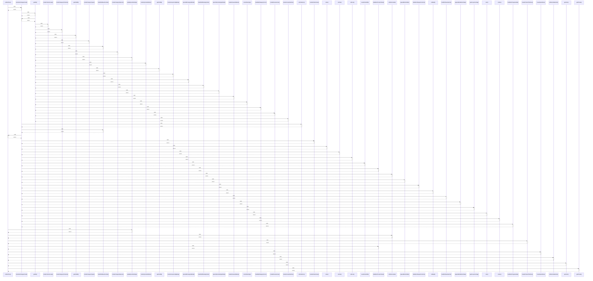

# ordUnitText()

> God node · 10 connections · [C:\Users\fadia\Downloads\erp-platform\foh-opening\js\domains\orders\orders-store.js](file:///C:/Users/fadia/Downloads/erp-platform/foh-opening/js/domains/orders/orders-store.js#L237)

## Call Trace Diagram

## Connections by Relation

### calls
- [[renderItemStepperCard()]] `INFERRED`
- [[updateQuickItemQty()]] `INFERRED`
- [[ordStockLabel()]] `EXTRACTED`
- [[createProductPickRow()]] `INFERRED`
- [[buildItemProductPanel()]] `INFERRED`
- [[createQuickRow()]] `INFERRED`
- [[ordStockRatioHint()]] `EXTRACTED`
- [[getUnits()]] `EXTRACTED`
- [[getPlurals()]] `EXTRACTED`

### contains
- [[orders-store.js]] `EXTRACTED`

---

*Part of the graphify knowledge wiki. See [[index]] to navigate.*