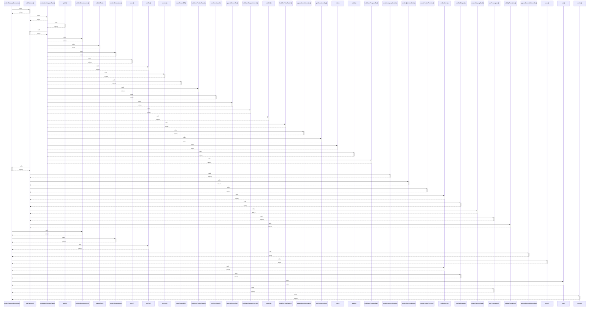

# renderCategoryComplete()

> God node · 12 connections · [C:\Users\fadia\Downloads\erp-platform\foh-opening\js\domains\orders\orders-view-review.js](file:///C:/Users/fadia/Downloads/erp-platform/foh-opening/js/domains/orders/orders-view-review.js#L18)

## Call Trace Diagram

## Connections by Relation

### calls
- [[ordCatItems()]] `INFERRED`
- [[buildOrdBreadcrumbs()]] `INFERRED`
- [[renderOrdersView()]] `INFERRED`
- [[ordCat()]] `INFERRED`
- [[appendGeneralBottomBar()]] `INFERRED`
- [[store()]] `EXTRACTED`
- [[ordCatDone()]] `INFERRED`
- [[ordCatSkipped()]] `INFERRED`
- [[isAr()]] `EXTRACTED`
- [[ordPendingItem()]] `INFERRED`
- [[ordGo()]] `EXTRACTED`

### contains
- [[orders-view-review.js]] `EXTRACTED`

---

*Part of the graphify knowledge wiki. See [[index]] to navigate.*