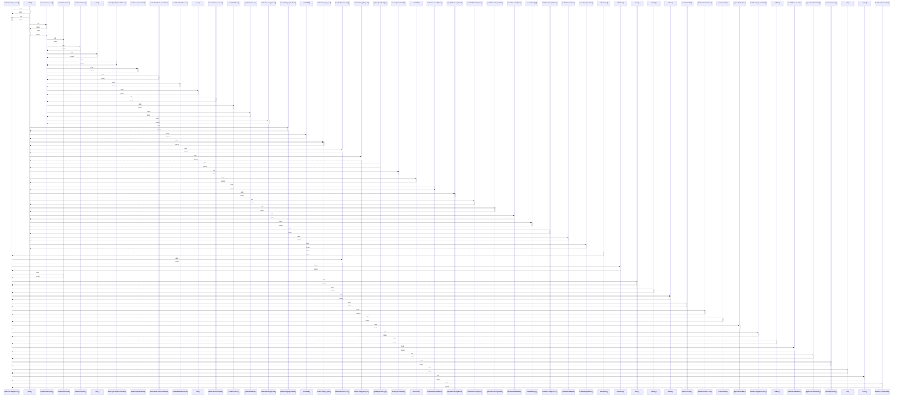

# renderItemStepperCard()

> God node · 21 connections · [C:\Users\fadia\Downloads\erp-platform\foh-opening\js\domains\orders\orders-view-step.js](file:///C:/Users/fadia/Downloads/erp-platform/foh-opening/js/domains/orders/orders-view-step.js#L264)

## Call Trace Diagram

## Connections by Relation

### calls
- [[getDB()]] `INFERRED`
- [[ordCatItems()]] `INFERRED`
- [[buildOrdBreadcrumbs()]] `INFERRED`
- [[ordUnitText()]] `INFERRED`
- [[renderOrdersView()]] `INFERRED`
- [[store()]] `EXTRACTED`
- [[ordCat()]] `INFERRED`
- [[ordLine()]] `INFERRED`
- [[saveOrdersDB()]] `INFERRED`
- [[buildItemProductPanel()]] `EXTRACTED`
- [[ordStockLabel()]] `INFERRED`
- [[appendBottomBar()]] `INFERRED`
- [[buildItemStepperControls()]] `EXTRACTED`
- [[ordById()]] `INFERRED`
- [[buildOrdViewSwitch()]] `INFERRED`
- [[appendItemBottomNav()]] `EXTRACTED`
- [[getGroupIconSvg()]] `INFERRED`
- [[isAr()]] `EXTRACTED`
- [[ordGo()]] `EXTRACTED`
- [[buildItemProgressRail()]] `EXTRACTED`

### contains
- [[orders-view-step.js]] `EXTRACTED`

---

*Part of the graphify knowledge wiki. See [[index]] to navigate.*